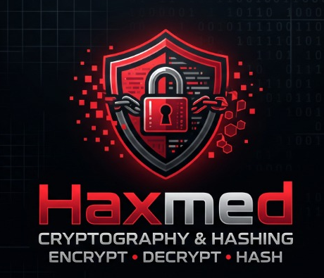

# 🛡️ HAXMED CryptoLab

<p align="center">
  
</p>

<p align="center">
  <strong>Professional Cross-Platform Cryptography & Cryptanalysis Desktop Toolkit</strong><br/>
  <em>منصة سطح مكتب هندسية متكاملة لتعلم واختبار وتدقيق التشفير والهاش والتحليل الجنائي للبيانات</em>
</p>

<p align="center">
  
  
  
  
  
  
</p>

---

## 📑 فهرس الدليل الشامل (Table of Contents)

1. [🚀 التشغيل بضغطة زر واحدة (1-Click Launch Methods)](#1--التشغيل-بضغطة-زر-واحدة-1-click-launch-methods)
2. [🧭 دليل كل نافذة وخيار بالتفصيل (Complete Modules & Options Manual)](#2--دليل-كل-نافذة-وخيار-بالتفصيل-complete-modules--options-manual)
   - [الوحدة A: لوحة التحكم والفاحص الشامل (Dashboard & Universal Inspector)](#وحدة-a-لوحة-التحكم-والفاحص-الشامل-dashboard--universal-inspector)
   - [الوحدة B: استوديو التشفير (Encryption Studio)](#وحدة-b-استوديو-التشفير-encryption-studio)
     - [1. التشفير الكلاسيكي والتاريخي (Classical Ciphers)](#1-التشفير-الكلاسيكي-والتاريخي-classical-ciphers)
     - [2. التشفير الحديث والقياسي (Modern Cryptography)](#2-التشفير-الحديث-والقياسي-modern-cryptography)
   - [الوحدة C: منصة تحليل وحساب الهاش (Hash Workbench)](#وحدة-c-منصة-تحليل-وحساب-الهاش-hash-workbench)
   - [الوحدة D: مختبر استرجاع الهاش المصرح به (Authorized Hash Recovery Lab)](#وحدة-d-مختبر-استرجاع-الهاش-المصرح-به-authorized-hash-recovery-lab)
   - [الوحدة E: محلل الشفرات الإحصائي (Cipher Analyzer)](#وحدة-e-محلل-الشفرات-الإحصائي-cipher-analyzer)
   - [الوحدة F: سجل العمليات والتدقيق (History & Audit Log)](#وحدة-f-سجل-العمليات-والتدقيق-history--audit-log)
   - [الوحدة G: إعدادات البرنامج (Settings)](#وحدة-g-إعدادات-البرنامج-settings)
3. [🔍 محرك التعرف التلقائي الذكي (Smart Auto-Detection Engine)](#3--محرك-التعرف-التلقائي-الذكي-smart-auto-detection-engine)
4. [🔒 معايير الأمان والخصوصية الصارمة (Privacy & Security Model)](#4--معايير-الأمان-والخصوصية-الصارمة-privacy--security-model)
5. [🧪 الاختبارات الآلية ومراقبة الجودة (Automated Testing & QA)](#5--الاختبارات-الآلية-ومراقبة-الجودة-automated-testing--qa)
6. [📦 إعادة التجميع والحزم (PyInstaller Packaging)](#6--إعادة-التجميع-والحزم-pyinstaller-packaging)

---

## 1. 🚀 التشغيل بضغطة زر واحدة (1-Click Launch Methods)

تم تجهيز التطبيق ليعمل فورياً دون تعقيد بثلاث طرق مختلفة:

### الطريقة الأولى: الضغط مرتين على ملف التشغيل السريع (Recommended)
في المجلد الرئيسي للمشروع، اضغط مرتين (Double Click) على:
👉 **`HAXMED_CryptoLab.bat`**
* يقوم هذا الملف بالتحقق تلقائياً من الملف التنفيذي المجمّع وتشغيله، أو تشغيل البيئة الافتراضية بايثون فوراً في ثوانٍ.

### الطريقة الثانية: تشغيل الملف التنفيذي المباشر (Standalone EXE)
افتح المجلد `release` واضغط مرتين على:
👉 **`release\HAXMED-CryptoLab\HAXMED-CryptoLab.exe`**
* ملف تنفيذي مدمج لا يتطلب تثبيت بايثون على جهازك، ويحتوي على أيقونة التطبيق الرسمية وكافة المكتبات اللازمة.

### الطريقة الثالثة: التشغيل عبر سطر الأوامر (Terminal / CLI)
```powershell
# تفعيل البيئة الافتراضية وتشغيل البرنامج
.\.venv\Scripts\Activate.ps1
python -m haxmed_cryptolab
```

---

## 2. 🧭 دليل كل نافذة وخيار بالتفصيل (Complete Modules & Options Manual)

---

### وحدة A: لوحة التحكم والفاحص الشامل (Dashboard & Universal Inspector)

تعتبر لوحة التحكم هي الواجهة المركزية التي تمنحك نظرة شاملة وفورية على حالة النظام وأدوات التشفير.

```
┌────────────────────────────────────────────────────────────────────────┐
│  🛡️ HAXMED CryptoLab v1.0.0 — Security Engineering                    │
│  ENCRYPT • DECRYPT • HASH • RECOVER • ANALYZE                          │
├────────────────────────────────────────────────────────────────────────┤
│  🔍 Universal Crypto Inspector & Auto-Detector                         │
│  [ Paste any ciphertext, hash, or container here...                 ]  │
│  [ 🔍 Inspect & Auto-Detect ] ──> [ ➡️ Open in Module ]                │
├──────────────────┬──────────────────┬─────────────────┬────────────────┤
│ 💻 OS Diagnostics│ 🐍 Python Engine │ 📜 Audit Status │ ⚙️ Active Tasks│
└──────────────────┴──────────────────┴─────────────────┴────────────────┘
```

#### الخيارات والأدوات المتوفرة:
1. **🔍 Universal Crypto Inspector (فاحص التشفير والهاش الشامل):**
   * **وظيفته:** التعرف التلقائي على أي نص مجهول (سواء كان نصاً مشفراً بقيصر، أو كبسولة AES-GCM، أو هاش MD5 / SHA-256، أو هاش Bcrypt / Argon2، أو مفتاح RSA PEM).
   * **كيفية استخدامه:**
     1. الصق النص المجهول في صندوق الإدخال `Inspect Input`.
     2. اضغط على زر **`🔍 Inspect & Auto-Detect`**.
     3. يعرض لك المحرك التشخيص فوراً: نوع الخوارزمية، نسبة التأكيد، والمفتاح المقترح إن وُجد.
     4. يظهر لك زر توجيه ذكي بنقرة واحدة (مثل `➡️ Open in Caesar Cipher` أو `➡️ Open in Hash Workbench`)؛ بالضغط عليه ينقلك فوراً للنافذة المعنية مع نقل النص وضبط الإعدادات تلقائياً.

2. **System Diagnostics Metrics (مؤشرات تشخيص النظام):**
   * **نظام التشغيل (OS Platform):** يعرض إصدار الويندوز أو اللينكس بدقة.
   * **محرك بايثون (Python Version):** يعرض رقم إصدار البيئة التشغيلية.
   * **حالة سجل التدقيق (History Audit):** يوضح هل حفظ السجل مفعل أم معطل لأسباب الخصوصية.
   * **المهام النشطة (Active Tasks):** يوضح إذا كانت هناك عمليات تجري في الخلفية (كحساب هاش ملف كبير أو استرجاع كلمة مرور).

3. **Quick Action Cards (كروت الوصول السريع):**
   * أزرار انتقال فورية لكل من: Encryption Studio، Hash Workbench، Recovery Lab، و Cipher Analyzer.

---

### وحدة B: استوديو التشفير (Encryption Studio)

تنقسم هذه الوحدة إلى قسمين رئيسيين: **التشفير الكلاسيكي** و **التشفير الحديث**.

#### زر الفحص الذكي المشترك (`🔍 Auto-Detect Type`):
في أعلى الاستوديو، عند لصق أي نص مشفر في خانة `Input Text`، يمكنك الضغط على هذا الزر ليقوم المحرك بالتعرف على نوع التشفير وتوجيهك تلقائياً للتبويب المناسب وتعبئة المفتاح!

---

#### 1. التشفير الكلاسيكي والتاريخي (Classical Ciphers)
> ⚠️ **تنبيه تعليمي:** الخوارزميات الكلاسيكية مخصصة للأغراض التعليمية ودراسة تاريخ التشفير فقط، وغير صالحة إطلاقاً لحماية البيانات الحساسة أو كلمات المرور.

* **1. Caesar Cipher (شفرة قيصر الإزاحية):**
  * **استخدامها:** إزاحة كل حرف في النص بعدد محدد من المواضع في الأبجدية الإنجليزية ($A \rightarrow D$ عند إزاحة 3).
  * **طريقة الاستخدام:**
    1. اكتب النص في خانة `Input Text`.
    2. حدد قيمة الإزاحة من 0 إلى 25 في خانة `Shift (Key)`.
    3. اختر `Encrypt` للتشفير أو `Decrypt` لفك التشفير.
    4. **زر `⚡ 25-Shift Brute Force Explorer`:** يقوم بتجربة كافة الإزاحات الـ 25 الممكنة بضغطة واحدة، ويعرضها في جدول مرتب يوضح كل إزاحة والنص الناتج عنها لتتمكن من قراءة النص دون معرفة المفتاح مسبقاً!

* **2. Atbash Cipher (شفرة أتباش العكسية):**
  * **استخدامها:** استبدال الحرف الأول بالأخير، والثاني بقبل الأخير ($A \leftrightarrow Z, B \leftrightarrow Y$). وهي شفرة ذاتية الانعكاس (التشفير وفك التشفير هما نفس العملية).
  * **طريقة الاستخدام:** لا تتطلب أي مفتاح؛ فقط ضع النص واضغط `Transform (Encrypt/Decrypt)`.

* **3. Vigenère Cipher (شفرة فيجينير متعددة الأبجديات):**
  * **استخدامها:** تشفير يعتمد على كلمة مفتاحية نصية (Passphrase) لتطبيق إزاحات متغيرة لكل حرف، مما يكسر تكرار الحروف البسيط.
  * **طريقة الاستخدام:**
    1. اكتب النص في خانة الإدخال.
    2. اكتب كلمة المفتاح في خانة `Key (Alphabetic Word)` (مثلاً: `SECRET` أو `HAXMED`).
    3. اختر `Encrypt` أو `Decrypt`.

* **4. Monoalphabetic Substitution (الاستبدال الأحادي الكامل):**
  * **استخدامها:** استبدال كامل الأبجدية الـ 26 بحروف أبجدية أخرى مبعثرة ومخصصة (Bijective Mapping).
  * **طريقة الاستخدام:**
    1. ضع مفتاح التبديل المكوّن من 26 حرفاً فريداً تماماً في خانة `Substitution Alphabet Key`.
    2. يوفر البرنامج زراً لتوليد مفتاح عشوائي معتمد (`🎲 Generate Random Key`).
    3. يتحقق البرنامج بدقة من عدم وجود تكرار أو نقص في الحروف، ثم تختار `Encrypt` أو `Decrypt`.

* **5. Transposition Cipher / Rail Fence (شفرة التبديل والمسارات):**
  * **استخدامها:** تغيير مواضع وترتيب الحروف عبر مسارات متعرجة كالسكك الحديدية بدلاً من استبدال الحروف.
  * **طريقة الاستخدام:**
    1. حدد عدد المسارات `Number of Rails (Key >= 2)`.
    2. اختر `Encrypt` لإعادة ترتيب النص على شكل مسارات، أو `Decrypt` لإعادة تجميع النص لأصله.

* **الأزرار المساعدة المشتركة في الشفرات الكلاسيكية:**
  * `📋 Copy Output`: نسخ النص الناتج للحافظة.
  * `🗑️ Clear`: تفريغ الخانات للبدء من جديد.
  * `📂 Load File (.txt)`: قراءة ملف نصي من جهازك مباشرة.
  * `💾 Save Output (.txt)`: حفظ النتيجة في ملف نصي.

---

#### 2. التشفير الحديث والقياسي (Modern Cryptography)
تستخدم خوارزميات معيارية راسخة من مكتبة `cryptography` الاحترافية ومولد أرقام عشوائية آمن برمجياً (OS CSPRNG).

* **1. AES-GCM (Advanced Encryption Standard - Galois/Counter Mode):**
  * **استخدامه:** التشفير المتناظر الأكثر أماناً واعتماداً عالمياً (AEAD). يضمن سرية البيانات وسلامتها التامة ضد التلاعب.
  * **طريقة الاستخدام:**
    1. **توليد المفتاح:** اضغط `🔑 Generate Key` لتوليد مفتاح عشوائي مشفر بقوة 256 بت بصيغة Hexadecimal، أو الصق مفتاحك الخاص المكوّن من 64 خانة Hex.
    2. **التشفير (`Encrypt`):** اكتب النص الصريح، واضغط تشفير. يقوم البرنامج بإنشاء كبسولة JSON قياسية وموثقة تحتوي على:
       * النص المشفر (Ciphertext).
       * الرمز الأولي الآمن المتغير (Nonce بقوة 96 بت).
       * تاج التوثيق والتحقق (Auth Tag بقوة 128 بت).
       * رقم إصدار الكبسولة (`v1.0`).
    3. **فك التشفير (`Decrypt`):** الصق كبسولة الـ JSON والمفتاح واضغط فك التشفير.
    4. **كشف التلاعب (Tamper Detection):** إذا تم تغيير حرف واحد فقط داخل الكبسولة أو في التاج، يرفض البرنامج فك التشفير فوراً ويطلق تحذيراً أمنياً بأن البيانات تعرضت للتعديل أو التلف.

* **2. RSA-OAEP (التشفير بالمفتاح العام والخاص):**
  * **استخدامه:** تشفير البيانات والمفاتيح السرية باستخدام المفتاح العام (Public Key)، وفكها حصرياً بواسطة المفتاح الخاص (Private Key).
  * **طريقة الاستخدام:**
    1. **توليد زوج المفاتيح:** حدد حجم المفتاح (2048 بت أو 4096 بت) واضغط `🔑 Generate RSA Key Pair`.
    2. يوفر البرنامج تصدير واستيراد المفاتيح بصيغة `PEM` القياسية المتوافقة مع OpenSSL.
    3. **التشفير:** الصق المفتاح العام والنص المراد حمايته واضغط `Encrypt (Public Key)`. (ينبهك البرنامج لقيود حجم النص القصوى لمنع تجاوز سعة OAEP).
    4. **فك التشفير:** الصق المفتاح الخاص واضغط `Decrypt (Private Key)`.

* **3. RSA-PSS (التوقيع الرقمي والتحقق من الهوية):**
  * **استخدامه:** إثبات صحة ومصدر الرسائل والملفات وعدم إنكارها، والتأكد من أنها لم تُعدل منذ توقيعها.
  * **طريقة الاستخدام:**
    1. **التوقيع (`Sign Message`):** أدخل النص والمفتاح الخاص واضغط `Sign`. يتم توليد توقيع رقمي رقمي مشفر بصيغة Hexadecimal / Base64.
    2. **التحقق من التوقيع (`Verify Signature`):** أدخل النص الأصلي، والتوقيع المستلم، والمفتاح العام للمرسل، واضغط `Verify Signature`.
    3. النتيجة: يعرض البرنامج بوضوح إما ✅ **VALID SIGNATURE** (التوقيع سليم 100%) أو ❌ **INVALID SIGNATURE** (التوقيع غير مطابق أو الرسالة معدلة).

---

### وحدة C: منصة تحليل وحساب الهاش (Hash Workbench)

تعتبر هذه المنصة مختبراً متخصصاً لدراسة بصمات البيانات والتحقق من سلامة الملفات.

#### الخوارزميات المدعومة:
* `SHA-256` & `SHA-512` (معيار SHA-2 الأكثر استخداماً عالمياً).
* `SHA3-256` & `SHA3-512` (معيار Keccak الحديث المقاوم لهجمات الإطالة).
* `MD5` & `SHA-1` (مدعومة لأغراض التوافق القديم والدراسة الأكاديمية مع تحذير أمني بعدم استخدامهما في التطبيقات الحديثة).

#### الخيارات والأدوات:
1. **Text Hashing (حساب هاش النصوص):**
   * اكتب أي نص -> اختر الخوارزمية -> اضغط `Calculate Hash` للحصول على بصمة الـ Hexadecimal فوراً.

2. **Chunked File Hashing (حساب هاش الملفات الضخمة):**
   * اختر ملفاً من جهازك (مهما كان حجمه: 1 جيجابايت، 10 جيجابايت...).
   * يستخدم البرنامج تقنية القراءة المجزأة (Chunked Stream بمقدار 64KB لكل دورة)، مما يحمي ذاكرة الجهاز (RAM) من الامتلاء ويضمن عدم تجمد الواجهة مع شريط تقدم حي.

3. **Hash Comparison & Integrity Verification (مطابقة وتدقيق الهاش):**
   * الصق الهاش المتوقع في خانة `Expected / Target Digest`.
   * اضغط `Compare / Verify`.
   * يقارن البرنامج البصمتين باستخدام دوال المقارنة في زمن ثابت (`hmac.compare_digest`) لمنع هجمات التوقيت الجانبية (Timing Attacks).
   * يعطيك نتيجة واضحة:
     * 🟢 **MATCH (مطابق):** الملف أو النص سليم ومطابق للبصمة.
     * 🔴 **NO MATCH (غير مطابق):** اختلاف في البيانات.
     * ⚠️ **INVALID FORMAT:** البصمة المدخلة طولها أو ترميزها غير صحيح.

4. **Auto-Detect Hash Type (التعرف التلقائي على نوع الهاش):**
   * زر `🔍 Auto-Detect Type` يقوم بفحص الهاش الملصوق وتحديد الخوارزمية المتطابقة معه تلقائياً، وضبط القائمة المنسدلة فوراً.

5. **Hashing Education (التوعية الأمنية):**
   * شرح تفاعلي مدمج يوضح الفرق بين التشفير والهاش، ولماذا لا يعتبر الهاش تشفيراً، ولماذا لا يمكن استرجاعه بعملية فك وهمية، وخطورة تصادمات MD5.

---

### وحدة D: مختبر استرجاع الهاش المصرح به (Authorized Hash Recovery Lab)

> ⚖️ **إخلاء مسؤولية أمني وقانوني:** هذا المختبر مخصص ومصمم حصرياً للاختبارات المصرح بها، ولعينات المعامل التعليمية، واختبار مدى قوة كلمات المرور التي تملكها فقط. يمنع استخدامه في أي نشاط غير قانوني.

بيئة فحص وتدقيق محلية تعمل في مسار معزول (Thread) لا تجمد البرنامج إطلاقاً مع إمكانية الإيقاف اللحظي.

```
┌────────────────────────────────────────────────────────────────────────┐
│  🧪 Authorized Hash Recovery Lab                                       │
│  Target Hash: [ 5d41402abc4b2a76b9719d911017c592                 ]     │
│  Wordlist:    [ C:/wordlists/samples.txt        ] [ 📂 Browse... ]     │
│  Algorithm:   [ MD5 / SHA-256 / Bcrypt / Argon2id            ▼ ]     │
├────────────────────────────────────────────────────────────────────────┤
│  Transformation Rules (قواعد تحوير الكلمات):                           │
│  [x] Uppercase    [x] Lowercase    [x] Capitalize                      │
│  Prefix: [ test_      ]   Suffix: [ !@#        ]                       │
│  Append Numbers: [0] to [99]                                           │
├────────────────────────────────────────────────────────────────────────┤
│  Progress: [████████████████████░░░░░░] 68% (12,450 H/s)               │
│  [ 🚀 Start Recovery ]   [ ⏹️ Cancel / Stop ]   [ 📄 Export Report ]   │
└────────────────────────────────────────────────────────────────────────┘
```

#### الخيارات وطريقة الاستخدام خطوة بخطوة:
1. **Target Hash (الهاش المستهدف):** ضع الهاش المراد اختباره والتأكد من وجود كلمته الأصلية في القاموس.
2. **Wordlist Selection (تحميل القاموس):** اضغط `Browse` لاختيار ملف الكلمات (`.txt` أو `.dic`). يفحص البرنامج تشفير الملف ويقرأه بدقة ويحسب عدد الكلمات ويتجاهل الفراغات.
3. **Algorithm Adapter (محول الخوارزمية):**
   * **Raw Digests:** يدعم MD5، SHA-1، SHA-256، SHA-512.
   * **Bcrypt:** يدعم قراءة وتدقيق هاشات Bcrypt مع احترام الـ Salt والـ Cost العامل بدقة.
   * **Argon2id:** يدعم هاشات خوارزمية Argon2id الحديثة مع ضبط الذاكرة ومسارات التنفيذ.
4. **Candidate Transformation Rules (قواعد التحوير):**
   * خيارات لتوليد احتمالات إضافية من كل كلمة دون تعديل الملف الأصلي:
     * `Uppercase`: تحويل الكلمة لحروف كبيرة (`admin` $\rightarrow$ `ADMIN`).
     * `Lowercase`: تحويل الكلمة لحروف صغيرة.
     * `Capitalize`: تكبير الحرف الأول (`password` $\rightarrow$ `Password`).
     * `Prefix`: إضافة كلمة أو رمز في البداية.
     * `Suffix`: إضافة كلمة أو رمز في النهاية.
     * `Append Numbers`: إضافة أرقام تلقائية متسلسلة (مثلاً من 0 إلى 99).
5. **Execution & Control (التشغيل والتحكم):**
   * اضغط `🚀 Start Recovery` لبدء الفحص.
   * يعرض البرنامج: عدد المحاولات، النسبة المئوية، السرعة اللحظية (Hashes/sec)، والوقت المنقضي.
   * زر `⏹️ Cancel`: يوقف الفحص فوراً وبأمان تام.
6. **النتائج والتقارير:**
   * عند العثور على الكلمة: تظهر رسالة نجاح مع الكلمة المسترجعة.
   * عند عدم العثور: تظهر رسالة تفيد بانتهاء القاموس دون تطابق.
   * زر `📄 Export Report`: تصدير تقرير ملخص معقم لا يحتوي على بيانات سرية لتوثيق الفحص الأمني.

---

### وحدة E: محلل الشفرات الإحصائي (Cipher Analyzer)

مختبر التحليل الجنائي للتعمية الكلاسيكية والنصوص المشفرة (Cryptanalysis).

#### الأدوات المتوفرة:
1. **Letter Frequency Histogram (تحليل تكرار الحروف):**
   * يقوم برسم بياني إحصائي لتكرار كل حرف من الـ 26 في النص المشفر.
   * يقارن التوزيع مباشرة مع التردد الطبيعي للغة الإنجليزية القياسية المعروف بترتيب (`ETAOIN SHRDLU`).
2. **Index of Coincidence (IoC - مؤشر التطابق):**
   * يقيس مدى عشوائية وتكرار الحروف في النص:
     * إذا كان المؤشر قريباً من **0.065**: فهذا يشير بنسبة كبيرة إلى أن التشفير **أحادي الأبجدية (Monoalphabetic مثل قيصر أو الاستبدال)**.
     * إذا كان المؤشر قريباً من **0.038**: فهذا يشير إلى تشفير **متعدد الأبجديات (Polyalphabetic مثل فيجينير)**.
3. **Automated Caesar Solver via Chi-Squared ($\chi^2$):**
   * بضغطة زر واحدة، يحلل النص ويجري اختبار كاي-تربيع الإحصائي على جميع الإزاحات الـ 26 الممكنة.
   * يفرز النتائج ويعرض لك الإزاحة الفائزة والنص المفكوك الأكثر ترجيحاً أنه لغة إنجليزية حقيقية.

---

### وحدة F: سجل العمليات والتدقيق (History & Audit Log)

سجل محلي لحفظ وتتبع العمليات المنفذة في البرنامج لأغراض التدقيق والدراسة.

#### معايير الخصوصية الصارمة للسجل:
* 🛡️ **معطل افتراضياً:** يجب تفعيله يدوياً من الإعدادات إذا رغب المستخدم.
* 🚫 **صفر نصوص سرية:** لا يتم إطلاقاً تخزين النصوص الصريحة (Plaintexts)، أو المفاتيح السرية (Private Keys / AES Keys)، أو كلمات المرور.
* 📋 **ما يتم تسجيله فقط:** اسم العملية، الخوارزمية، بصمة الهاش أو حجم البيانات، التاريخ والوقت، وحالة نجاح أو فشل العملية.

#### الخيارات:
* `🔄 Refresh`: تحديث جدول العمليات.
* `📄 Export as Text / JSON`: تصدير تقرير السجل للاحتفاظ به.
* `🗑️ Clear All History`: مسح وتصفير السجل وقاعدة البيانات بالكامل بشكل لا رجعة فيه.

---

### وحدة G: إعدادات البرنامج (Settings)

نافذة تخصيص تجربة الاستخدام ومظهر ولغة البرنامج.

#### الخيارات:
1. **Language (اللغة):**
   * التبديل اللحظي بين **العربية (RTL مع محاذاة يمين-يسار)** و **الإنجليزية (LTR)**.
   * تتغير الواجهة وجميع القوائم والنصوص والشروحات فوراً دون الحاجة لإعادة تشغيل البرنامج.
2. **Theme (المظهر والألوان):**
   * `Dark Charcoal & Crimson`: المظهر الليلي السيبراني الفخم باللون الفحمي وأحمر الهاكر المتوهج.
   * `Light Modern`: المظهر النهاري الواضح والأنيق.
3. **Privacy Settings (إعدادات الخصوصية):**
   * خيار تفعيل أو تعطيل حفظ سجل العمليات.
4. **Reset Defaults:**
   * استعادة ضبط المصنع للإعدادات الافتراضية.

---

## 3. 🔍 محرك التعرف التلقائي الذكي (Smart Auto-Detection Engine)

يحتوي HAXMED CryptoLab على محرك ذكي مبني في [`SmartDetector`](src/haxmed_cryptolab/engines/analysis/detector.py):

| ما تدخله في البرنامج | ما يتعرف عليه المحرك تلقائياً | الإجراء التلقائي المقترح |
| :--- | :--- | :--- |
| نص مشفر بقيصر مثل `KHOOR ZRUOG` | Caesar Cipher (Shift 3) | توجيه لتبويب قيصر، تعيين المفتاح 3، وتفعيل خيار Decrypt |
| كبسولة JSON تحتوي على `nonce`, `tag` | AES-GCM Container | توجيه لتبويب التشفير المتناظر AES-GCM |
| نص مكوّن من 32 خانة Hexadecimal | MD5 Hash | توجيه لمنصة الهاش وضبط الخوارزمية على MD5 |
| نص مكوّن من 40 خانة Hexadecimal | SHA-1 Hash | توجيه لمنصة الهاش وضبط الخوارزمية على SHA-1 |
| نص مكوّن من 64 خانة Hexadecimal | SHA-256 / SHA3-256 | ضبط الخوارزمية على SHA-256 للمطابقة |
| نص مكوّن من 128 خانة Hexadecimal | SHA-512 / SHA3-512 | ضبط الخوارزمية على SHA-512 للمطابقة |
| نص يبدأ بـ `$2a$` أو `$2b$` بطول 60 حرفاً | Bcrypt Password Hash | تنبيه بأنه هاش محمي وتوجيه لـ Recovery Lab |
| نص يبدأ بـ `$argon2id$` | Argon2id Hash | تنبيه وتوجيه لـ Recovery Lab لفحص القاموس |
| نص يبدأ بـ `-----BEGIN RSA...` | RSA Public/Private Key | توجيه لتبويب التشفير غير المتناظر RSA |

---

## 4. 🔒 معايير الأمان والخصوصية الصارمة (Privacy & Security Model)

صُمم البرنامج وفق مبدأ **Security by Design**:
1. **محلي بالكامل (100% Local Execution):** لا يقوم البرنامج بأي اتصال خارجي عبر الإنترنت إطلاقاً، ولا يرسل أي بيانات تحليلية (Zero Telemetry).
2. **عدم تخزين الأسرار (Zero-Knowledge Logging):** لا تُحفظ المفاتيح أو كلمات المرور في قاعدة البيانات.
3. **أمان الذاكرة والملفات:** تتم قراءة الملفات الكبيرة في صورة أجزاء صغيرة (Streaming Chunks) وتفريغ المؤقتات تلقائياً.
4. **مقارنة الهاش في زمن ثابت:** منع هجمات تحليل التوقيت الجانبي عبر استخدام دوال ثنائية معيارية آمنة.
5. **استخدام مكتبات تشفير معيارية:** عدم اختراع دوال تشفير حديثة من الصفر، والاعتماد الحصري على معايير OpenSSL ومكتبة `cryptography` الرسمية.

---

## 5. 🧪 الاختبارات الآلية ومراقبة الجودة (Automated Testing & QA)

يحتوي المشروع على حزمة اختبارات برمجية شاملة تضم **58 اختباراً آلياً** تغطي كافة المحركات والواجهات:

```powershell
# تشغيل كامل الاختبارات
$env:QT_QPA_PLATFORM="offscreen"
pytest tests/ -v
```

* ✅ `tests/unit/test_classical_ciphers.py`: اختبار كافة الشفرات الكلاسيكية والتحقق من المفاتيح.
* ✅ `tests/unit/test_modern_crypto.py`: اختبار كبسولات AES-GCM، وكشف التلاعب، ومفاتيح RSA-OAEP و RSA-PSS.
* ✅ `tests/unit/test_hashes.py`: اختبار صحة جميع خوارزميات الهاش وتدقيق الملفات الكبيرة.
* ✅ `tests/unit/test_detector.py`: اختبار دقة محرك التعرف التلقائي الذكي على كل الأنماط.
* ✅ `tests/security/test_security_and_privacy.py`: اختبار عدم تسريب أي أسرار لقاعدة البيانات.
* ✅ `tests/ui/test_main_window_ui.py`: اختبار تفاعل الواجهة والتبديل الديناميكي بين اللغات والمظاهر.

---

## 6. 📦 إعادة التجميع والحزم (PyInstaller Packaging)

لإعادة تجميع التطبيق إلى حزمة تنفيذية مستقلة تتضمن الأيقونة الرسمية وكافة الموارد:

```powershell
.\.venv\Scripts\pyinstaller.exe `
  --noconfirm `
  --onedir `
  --windowed `
  --name "HAXMED-CryptoLab" `
  --distpath "release" `
  --icon "src/haxmed_cryptolab/resources/icons/app_icon.ico" `
  --add-data "docs;docs" `
  --add-data "src/haxmed_cryptolab/resources;haxmed_cryptolab/resources" `
  --collect-all "PySide6" `
  --collect-all "cryptography" `
  --collect-all "bcrypt" `
  --collect-all "argon2" `
  "src/haxmed_cryptolab/__main__.py"
```

ستجد الملف التنفيذي النهائي المجمّع جاهزاً للتشغيل في:
`release\HAXMED-CryptoLab\HAXMED-CryptoLab.exe`

---

## 7. ⚖️ الترخيص وحقوق الملكية (License)

هذا المشروع مرخص ومتاح بموجب ترخيص **MIT License** — طُوّر وصُمم بواسطة فريق **HAXMED Security Engineering**.
راجع ملف [LICENSE](LICENSE) لمزيد من التفاصيل.
