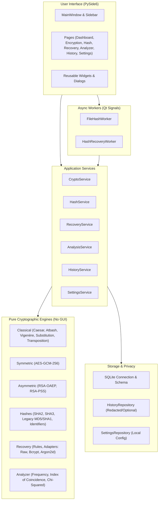

# HAXMED CryptoLab — Architecture Specification

## 1. Architectural Overview

HAXMED CryptoLab is built with a strictly decoupled, layered architecture to guarantee testability, maintainability, safety, and security.

The application follows the **Separation of Concerns (SoC)** principle:
- **Engines** contain mathematical and cryptographic logic and have **zero** dependencies on GUI frameworks (PySide6/Qt).
- **Services** orchestrate business flows, coordinate between engines, storage, and models, and enforce validations.
- **Workers** handle asynchronous, non-blocking execution using Qt's `QThread` and `QObject` signals, keeping the UI completely fluid.
- **UI** (PySide6) consists of views, widgets, and dialogs that communicate with services and trigger workers via signals and slots.
- **Storage** encapsulates SQLite database queries behind isolated repository interfaces with privacy-first redaction.



## 2. Directory Structure

```text
src/haxmed_cryptolab/
├── core/            # App metadata, error hierarchy, configuration constants, events
├── engines/         # Pure Python cryptographic algorithms
│   ├── classical/   # Caesar, Atbash, Vigenère, Monoalphabetic, Transposition
│   ├── symmetric/   # AES-GCM authenticated cipher with versioned container
│   ├── asymmetric/  # RSA-OAEP encryption & RSA-PSS digital signatures
│   ├── hashes/      # Hash computation, constant-time compare, format detector
│   ├── recovery/    # Wordlist processing, mutation rules, hash adapters
│   └── analysis/    # Frequency analysis, Caesar shift ranking, statistical tests
├── models/          # Data transfer objects, schemas, dataclasses, enums
├── security/        # Input sanitizer, secret redactor, safe path handler
├── services/        # Orchestrators bridging engines, storage, and UI
├── storage/         # SQLite persistence, migrations, repositories
├── workers/         # QThread workers for long-running non-blocking tasks
├── ui/              # PySide6 presentation layer
│   ├── dialogs/     # About, Key Export/Import, Report dialogs
│   ├── pages/       # Dashboard, Encryption, Hashes, Recovery, Analyzer, History, Settings
│   ├── widgets/     # Stat cards, code displays, status badges, progress views
│   ├── i18n.py      # Internationalization helper (EN LTR / AR RTL)
│   ├── navigation.py# Sidebar navigation with branding
│   └── main_window.py
└── app.py           # Application bootstrap and lifecycle manager
```

## 3. Communication Patterns

### Non-blocking Execution
CPU-bound operations (such as large file hashing and candidate wordlist verification) are dispatched to dedicated worker threads (`QThread`). 

The worker communicates progress, status updates, candidate match discoveries, and completion results exclusively through Qt Signals (`pyqtSignal` / `Signal`). The main GUI thread never blocks, ensuring the application remains interactive and cancellable at all times.

### Internationalization & RTL
The application provides full bilingual support for English (LTR) and Arabic (RTL). Language switching updates the layout direction dynamically via `QApplication.setLayoutDirection()` and translates all UI components without requiring application restarts.
